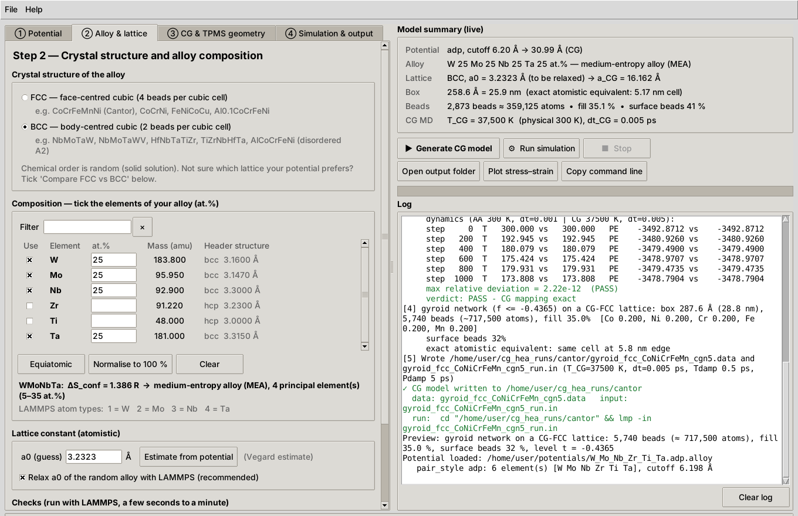

# CG-HEA TPMS Builder

Coarse-grained (CG) TPMS lattice models of **FCC and BCC high- and medium-entropy alloys**,
built from **your own atomistic interatomic potential** (EAM/alloy, EAM/FS, ADP or MEAM), with a
graphical interface and a command-line tool.

**Author:** Dr. Khaled Abdelghafar · **License:** MIT

The potential is rescaled with the exact map of Chalamet, Rodney & Shibuta
(*Comput. Mater. Sci.* 228 (2023) 112306): `E_CG(X) = n³·E_AA(X/n)`. A CG run at `T_CG = n³T`
with timestep `n·dt` is the atomistic trajectory of the same structure shrunk by `n`, so
stresses and elastic constants are unchanged and a CG cell of edge `L` behaves exactly like an
atomistic cell of edge `L/n`. Put another way, it is a similarity map onto a *smaller*
atomistic system with the same particle count. It is not a validated equivalent of a larger
all-atom specimen; size effects are those of the `L/n` cell.



## Files

| File | Purpose |
|---|---|
| `cg_hea_gui.py` | Graphical interface (Tkinter, no extra install) |
| `cg_hea_tpms.py` | Command line; opens the GUI when run without arguments |
| `cg_hea_core.py` | Engine shared by both: potential rescaling, FCC/BCC lattices, checks, TPMS, LAMMPS inputs |
| `examples/geometry_sweep.py` | Architecture-vs-bulk study: generate a sweep from your structure, then fit E, E/E_bulk and Gibson-Ashby scaling |
| `tests/test_core.py` | Unit tests plus FCC/BCC LAMMPS integration tests |
| `docs/` | Screenshots and an example stress-strain plot |
| `LICENSE`, `CITATION.cff` | MIT license; citation metadata ("Cite this repository" on GitHub) |

## Install

```bash
git clone https://github.com/kAbdleghafar/cg-hea-tpms.git
cd cg-hea-tpms
pip install -r requirements.txt        # numpy (+ matplotlib for previews and plots)
```

* **Tkinter** ships with the python.org installers on Windows and macOS. On Debian/Ubuntu,
  install it with `sudo apt install python3-tk`.
* **LAMMPS** (`lmp`) is needed to relax a0, run the checks and run the simulation. Generating
  the input files works without it. It needs `eam/alloy` / `eam/fs` / `adp` (MANYBODY package) or
  `meam` (MEAM package). `pip install lammps` works; on Linux that wheel also needs an MPICH
  runtime (`sudo apt install libmpich12`). The pip `lmp` is a Python wrapper: under `mpirun` it
  may start independent serial copies (the log says "on 1 procs"). For parallel production
  runs, use a native MPI build of LAMMPS and set the GUI's *MPI prefix* (e.g. `mpirun -np 8`).
* **Interatomic potentials are not included.** Use your own, or download one from the NIST
  Interatomic Potentials Repository (https://www.ctcms.nist.gov/potentials/) and follow its
  terms of use.

## Quick start: GUI

```bash
python3 cg_hea_gui.py          # or: python3 cg_hea_tpms.py
```

1. **Potential.** Click **Attach potential file(s)…** and select the file(s) you would use in an
   atomistic LAMMPS run: either one EAM or ADP file, or the MEAM library and parameter file
   together.
   The tool detects the format, validates it, and lists the elements in the file. For MEAM,
   enter the *library element order* from the potential's documentation.
2. **Alloy & lattice.** Choose **FCC** or **BCC**, tick your elements and set the at.%. The GUI
   shows ΔS_conf and whether the alloy counts as an HEA or an MEA. Keep **Relax a0** and
   **Verify** on. **Compare FCC vs BCC** tells you which lattice your potential prefers.
3. **CG & TPMS geometry.** Set the CG level `n`, the box size (in cells or in nm), the
   surface, network or sheet, and a target relative density. **Preview geometry** shows the
   beads before anything is written.
4. **Simulation & output.** Enter the physical T and dt (the CG scaling is applied for you),
   optional uniaxial compression, the LAMMPS executable and the output folder. The optional
   *Advanced* fields override the CG timestep and the thermostat/barostat damping times.

Then press **Generate CG model**. **Run simulation** launches LAMMPS (with an optional MPI
prefix) and streams its log. **Plot stress–strain** reads the compression output. Settings can
be saved and loaded as JSON, and **Copy command line** gives the equivalent CLI call for batch
or HPC runs.

## Quick start: command line

```bash
# FCC Cantor-type alloy with a 2NN-MEAM (library + parameter file)
python3 cg_hea_tpms.py --pair meam --library library.meam --params CoNiCrFeMn.meam \
    --lib-elements Co Ni Cr Fe Mn --elements Fe Ni Co Mn --lattice fcc -n 5 \
    --auto-a0 --verify --surface gyroid --cells 20 --crush

# BCC refractory HEA with an eam/alloy file
python3 cg_hea_tpms.py --pair eam --potential MoNbTaW.eam.alloy --elements Nb Mo Ta W \
    --lattice bcc -n 5 --auto-a0 --verify --compare-phases --surface gyroid --density 0.3

# BCC refractory HEA with an angular-dependent potential, box given in nm
python3 cg_hea_tpms.py --pair adp --potential W_Mo_Nb_Zr_Ti_Ta.adp.alloy \
    --elements Mo Nb Ta Ti W Zr --lattice bcc -n 5 --box-nm 100 --auto-a0 --verify --crush

# re-run settings saved by the GUI (flags given here override the file)
python3 cg_hea_tpms.py --config my_settings.json --cells 30
```

Run `python3 cg_hea_tpms.py --help` for every option. Besides the potential and alloy flags,
these include `--lattice {fcc,bcc}`, `--compare-phases`, `--phase {auto,network,sheet}`,
`--density`, `--min-coord`, `--box-nm`, `--crush-axis`, `--dt-cg`, `--tdamp`, `--pdamp`,
`--config`, `--save-config` and `--gui`. `--phase auto` uses `t > 0` → sheet, otherwise network
`f ≤ 0`. The exit code is 2 when verification fails; no model is written in that case.

## Comparing architectures against your bulk (polycrystal) reference

A TPMS generated by the tool is cut from a **single crystal** loaded along [100]. In elastically
anisotropic alloys that alone changes the stiffness. For example, the low-modulus β alloy
Ti43.75Zr28.125Nb28.125 (Starikov ADP) has Zener A = 3.3, E[100] = 42.6 GPa, E[111] = 126 GPa
and a polycrystal (Hill) modulus of 82.8 GPa. To compare geometries fairly against a simulated
bulk polycrystal, cut them **out of that same polycrystal**:

```bash
# atom types of the data file in --elements order; -n 1 keeps it atomistic, -n 5 scales it to CG
python3 cg_hea_tpms.py --pair adp --potential W_Mo_Nb_Zr_Ti_Ta.adp.alloy --elements Ti Zr Nb \
    --lattice bcc --matrix my_polycrystal.data -n 1 --surface gyroid --density 0.4 \
    --crush --crush-strain 0.03 --strain-rate 1e-3 --outdir gyroid_rho040
python3 cg_hea_tpms.py --analyze */*_stress_strain.txt --fit-window 0.002 0.01
```

For a whole study, `examples/geometry_sweep.py` builds every surface × density (× seed) from
the same structure, plus the bulk itself, and writes `run_all.sh`. After the runs it fits each
modulus, normalises it by the bulk, and fits `E*/E_bulk = C·ρ^m` per architecture.
`--target 20` reports the density needed for a 20 GPa (bone-like) lattice:

```bash
python3 examples/geometry_sweep.py generate --pair adp --potential W_Mo_Nb_Zr_Ti_Ta.adp.alloy \
    --elements Ti Zr Nb --matrix my_polycrystal.data --outroot sweep \
    --surfaces gyroid diamond primitive iwp --sheet gyroid --densities 0.25 0.35 0.5
cd sweep && LMP="mpirun -np 32 lmp" bash run_all.sh && cd ..
python3 examples/geometry_sweep.py summarize --outroot sweep --target 20
```

The sweep's defaults are compression to 3 % at 10⁻³ ps⁻¹, two seeds per case, and a fit
between 0.25 % and 1.5 %. In ~26,000-atom gyroids at 300 K, a 1 % compression left the lattice
stress buried in thermal and barostat noise (R² < 0.7), so check every stress-strain curve.

`--matrix` reads an orthogonal `atom_style atomic` data file (image flags and Velocities are
fine), keeps the atoms inside the TPMS solid, and scales the box by n. The composition is taken
from the file. In the GUI the same option is under ③ *Solid to carve the TPMS from*. `--analyze`
fits the apparent Young's modulus of each run, with its relative density. The elastic modulus
is size-independent, so it is the property that transfers best through the CG map.

## What FCC vs BCC changes

The CG map does not depend on the crystal structure, so the same rescaled potential serves
both lattices. What changes is:

* **Bead lattice:** 4 beads per cubic cell for FCC, 2 for BCC.
  `a_CG = n·a0`.
* **Lattice constant:** the random alloy is relaxed **in the chosen lattice** with the
  *atomistic* potential. That means an 864-atom FCC or 1024-atom BCC supercell, a coarse E(a)
  scan, then `box/relax`. The scan makes the result robust to a poor first guess. The first
  guess itself comes from Vegard's law on the atomic volumes in the potential header,
  converted to the target lattice. Header lattice labels are sometimes wrong: the Zhou EAM
  generator, for example, labels W "fcc".
* **Checks:** the pure-element check relaxes every element as both FCC and BCC, which confirms
  each atom type is the intended element. `--compare-phases` reports `E_BCC − E_FCC` for the
  random alloy. **Verify** warns when the random alloy is unstable in the chosen lattice.

## Verification (`--verify`)

* **Static tests, two configurations.** One is a distorted random-alloy bulk. The other is the
  same bulk with gyroid holes, which adds free surfaces (low-density EAM regions, MEAM
  screening). Coordinates are written at full precision. The AA and CG energies, all six
  stress components and every per-atom force must agree as n³, 1 and n² (typical agreement:
  10⁻¹⁴).
* **Dynamics:** 1 ps NVE at T (AA) and at n³T (CG), compared every 200 steps.
* **MEAM:** the exactness reference is the atomistic potential with ZBL switched off, as in the
  CG model. A `*_AA_noZBL.meam` file is written for this. When ZBL was on in your potential
  (explicitly or by the LAMMPS default), its effect is reported separately, against the
  original potential.
* **Instability flag:** when the random alloy is unstable in the chosen lattice (T rises during
  NVE), trajectories diverge through chaos even though the map is exact. The static tests
  still prove exactness, and you are warned that the lattice may be the wrong choice.
* **Failure stops the run:** if a static test fails, no model is written and the CLI exits with
  code 2.

## How each format is rescaled (E_CG(X) = n³·E(X/n))

| Format | Rescaling |
|---|---|
| EAM/alloy, EAM/FS | F × n³, r·φ × n⁴, ρ(r/n) (same values on an n-times longer r-grid), mass × n³ |
| ADP | as EAM, plus dipole u × n^½ and quadrupole w × n^−½ (μ and λ enter squared) |
| MEAM library | atwt, esub × n³; alat × n |
| MEAM parameters | Ec, delta × n³; re, rc, delr × n; repuls × n when `erose_form = 1` (the Rose energy then contains repuls/r); the default rc = 4 Å and delr = 0.1 Å are written out and scaled; ZBL off |

Unknown MEAM keywords are refused rather than copied unscaled, and setfl files must match
their format's table size exactly.

## Validated with real potentials

These checks used LAMMPS (22 Jul 2025), n = 5, at 300 K.

| Alloy | Lattice | Potential | a0 (random alloy) | E_BCC − E_FCC | Static check | 1 ps MD |
|---|---|---|---|---|---|---|
| CoCrFeMnNi | FCC | 2NN-MEAM, Choi *et al.* 2018 | 3.5953 Å (expt. ≈ 3.59–3.60) | +33.7 meV/atom | 1.7×10⁻¹³ | 3.1×10⁻¹² |
| NbMoTaW | BCC | ADP, Starikov (W-Mo-Nb-Zr-Ti-Ta) | 3.2288 Å (expt. ≈ 3.21) | −222 meV/atom | 1.7×10⁻¹³ | 4.2×10⁻¹² |
| TiZrNbTa | BCC | ADP, Starikov | 3.3574 Å | −45 meV/atom | 7.2×10⁻¹⁴ | 2.1×10⁻¹² |

Both potentials load without changes. For the MEAM pair, select the library and parameter file
together; the element order defaults to Co Ni Cr Fe Mn, and ZBL is already off in that file.
The pure-element checks reproduce each potential's reference lattice constants. In CG MD
(gyroid, 40 % dense, NPT at 300 K, then compression), both lattices stay at 300 K and
0 bar during equilibration and give positive compressive stress (`docs/stress_strain_user_potentials.png`).

## Output (in the output folder)

| File | What it is |
|---|---|
| `<surface>_<lattice>_<elements>_cgn<n>.data` | CG data file |
| `…_run.in` | LAMMPS input: minimise → NPT equilibration → optional compression |
| `*_CG_n<n>.*` | The rescaled potential, next to a copy of yours |
| `…_equilibrated.data`, `…_equilibrated.restart` | Written by the run, after equilibration |
| `…_config.json` | Your settings; reload them in the GUI or CLI |
| `…_summary.json` | a0, energies, check results, type → element map, bead counts |
| `checks/` | Inputs and logs of every check run |

The stress in `…_stress_strain.txt` is the whole-box value in GPa, positive in compression.
For a periodic TPMS cell this is the apparent stress of the cellular material.

## History: changes relative to the first `cg_hea_tpms.py` script

* FCC **and** BCC, a GUI, potential auto-detection and validation, a target relative density,
  dangling-bead pruning, a surface-bead (wall thickness) warning, and a choice of compression
  axis.
* **Stress sign:** the compression stress had the wrong sign. It was written as `−pzz`, which
  is negative in compression; it is now `+pzz`. On a dense block at 3 % strain the output went
  from −3.0 GPa to +3.0 GPa.
* Merged from the `cg_hea_tpms_flexible.py` variant: the stress-sign fix, `erose_form = 1` support, ADP,
  per-atom-force / full-stress / free-surface static checks at full precision, a strict MEAM
  keyword list and exact setfl table sizes, Fortran `D` exponents, `--box-nm`, `--dt-cg`,
  `--tdamp`, `--pdamp`, the restart file after equilibration, sorted dumps and a
  scale-consistent minimiser tolerance.
* **MEAM `rc`/`delr` defaults:** they were not rescaled when the parameter file relied on
  LAMMPS defaults (4.0 Å / 0.1 Å). The CG cutoff stayed 4 Å, so the CG model was wrong. They
  are now written explicitly, scaled by n.
* **ZBL:** it is switched off for every pair of the library elements. Before, it was only
  switched off up to the largest index found in the parameter file, so it stayed on when the
  file had no indexed keywords or no file was given.
* **Verify for MEAM:** it used to mix the ZBL removal into the exactness test. It is now
  separated, as described above.
* Exact-count composition rounding (largest remainder), first-match element lookup in MEAM
  libraries (as LAMMPS does), `shutil` copies instead of `cp`, paths with spaces, and
  Windows-safe commands.

## Limitations

* Random solid solutions only: no chemical short-range order, no B2/L1₂ ordering.
* Cubic FCC/BCC only (no HCP).
* Supported formats: EAM setfl (eam/alloy, eam/fs), ADP and MEAM (including 2NN). Not
  supported: funcfl `.eam`, eam/he, MS-MEAM, and machine-learned potentials. In CG-MEAM, ZBL
  is off.
* No check can detect a wrong MEAM library-element order: take it from the potential's
  documentation.

## Tests

```bash
python3 -m unittest discover -s tests -v     # set CG_HEA_LMP=/path/to/lmp for the LAMMPS tests
```

## Citation

If you use this software, please cite it (see `CITATION.cff`, or **Cite this repository** on
GitHub). Please also cite the coarse-graining method: Chalamet, Rodney & Shibuta,
*Comput. Mater. Sci.* 228 (2023) 112306. Cite the interatomic potentials you use as their
authors request.

## License

MIT © 2026 Dr. Khaled Abdelghafar. See [LICENSE](LICENSE).
